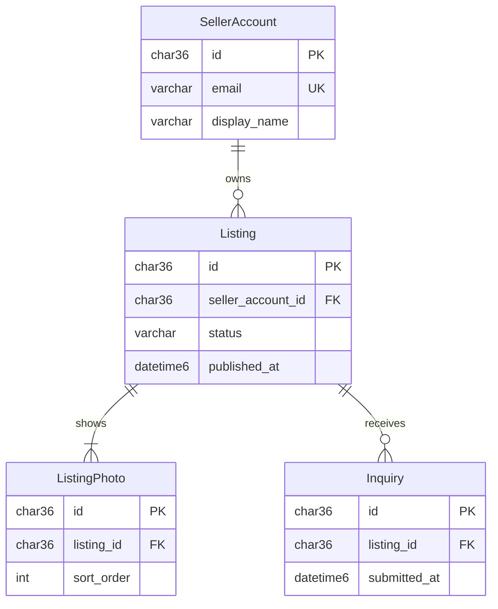

# Data Model: Public Car Marketplace

Database: MySQL 8.0 or 8.4, schema `car_marketplace`, charset `utf8mb4`, collation `utf8mb4_0900_ai_ci`.

ORM: EF Core 10, provider `Microting.EntityFrameworkCore.MySql` 10.0.14. Tables are created only by an EF Core migration. No seed in `Program.cs`. No `EnsureCreated`.

Primary keys are `char(36)` GUID strings. Timestamps are `datetime(6)` in UTC. API DTOs expose those timestamps as `DateTimeOffset` with offset zero. Price is `decimal(10,2)`. The API always sends `currencyCode` = `USD` and `mileageUnit` = `km`. Those two values are not columns.



## SellerAccount

A person who can publish and maintain listings. One role. No buyer account table.

| Column | Type | Rules |
| --- | --- | --- |
| `id` | `char(36)` PK | Generated GUID. |
| `email` | `varchar(254)` NOT NULL | Stored trimmed and lowercased. Unique. "A registration email comparison ignores letter case." |
| `display_name` | `varchar(80)` NOT NULL | Trimmed. "Display name and inquiry name are 1 to 80 characters." |
| `password_hash` | `varchar(500)` NOT NULL | Hash only. Never selected into an API DTO. The submitted password is at least 8 characters and at most 128 characters. |
| `created_at` | `datetime(6)` NOT NULL | UTC, set on insert. |
| `last_signed_in_at` | `datetime(6)` NOT NULL | UTC. Set when the account is created and when sign-in succeeds. The 14-day sliding session is enforced by the cookie, not by comparing this column on every request. |

Index: unique `ux_seller_accounts_email` on `email`.

The password is a secret used only to sign in. The public listing API never returns `email` or `password_hash`.

## Listing

One car offered by one seller. There is no draft and no deleted flag. A row exists only after a valid publish.

| Column | Type | Rules |
| --- | --- | --- |
| `id` | `char(36)` PK | Generated GUID. |
| `seller_account_id` | `char(36)` NOT NULL | FK to `seller_accounts.id`. `ON DELETE RESTRICT`. |
| `make` | `varchar(50)` NOT NULL | Trimmed. "Make and model are 1 to 50 characters." |
| `model` | `varchar(50)` NOT NULL | Trimmed. "Make and model are 1 to 50 characters." |
| `year` | `smallint` NOT NULL | "Year is a whole number from 1900 through the calendar year after the current year." Evaluated in UTC at save time. |
| `price` | `decimal(10,2)` NOT NULL | "Price is a number greater than 0 and at most 99,999,999.99, with at most two decimal places." Zero, negative, and an empty price are rejected. |
| `mileage_km` | `int` NOT NULL | "Mileage is a whole number of kilometers from 0 through 2,000,000." |
| `location` | `varchar(80)` NOT NULL | Trimmed. "Location is 2 to 80 characters." City and region text. No street and no coordinates. |
| `description` | `varchar(2000)` NOT NULL | "Description is 1 to 2000 characters after trimming blank space." |
| `status` | `varchar(16)` NOT NULL | "Status is the word Available or Sold." Check constraint: `status in ('Available', 'Sold')`. |
| `published_at` | `datetime(6)` NOT NULL | Set once on publish. Edits and status changes must not update it. |
| `updated_at` | `datetime(6)` NOT NULL | Set on publish and on every successful save. |

Indexes:

- `ix_listings_seller_account_id` on `seller_account_id`.
- `ix_listings_status_published_at_id` on `(status, published_at, id)` for the default browse (available, newest published first).

Check constraints (same bounds as the columns): year `>= 1900`, price `> 0` and `<= 99999999.99`, mileage `>= 0` and `<= 2000000`. The upper year bound is enforced in the service because it moves with the calendar.

### State transitions

```text
(create) --> Available
Available --> Sold        owner only
Sold --> Available        owner only
```

No other status exists. Nobody except the signed-in owner may change facts, photos, or status. A later successful save by that owner is the row buyers see. There is no delete transition in this release.

## ListingPhoto

A still image attached to one listing. The listing always has 1 to 10 rows after a successful publish or photo replace.

| Column | Type | Rules |
| --- | --- | --- |
| `id` | `char(36)` PK | Generated GUID. Also used as the stored file name. |
| `listing_id` | `char(36)` NOT NULL | FK to `listings.id`. `ON DELETE RESTRICT`. |
| `sort_order` | `tinyint` NOT NULL | `0` through `9`. Unique per listing `(listing_id, sort_order)`. `0` is the cover. "The first photo is the cover photo." |
| `content_type` | `varchar(32)` NOT NULL | `image/jpeg`, `image/png`, or `image/webp` after re-encode. |
| `stored_file_name` | `varchar(64)` NOT NULL | Generated. The original upload name is discarded. |
| `byte_size` | `int` NOT NULL | `1` through `8388608`. "A photo that is not a still image, or a still image larger than 8 MB, is rejected. Video is rejected." |

Index: unique `ux_listing_photos_listing_sort` on `(listing_id, sort_order)`.

Files are not stored in this table. `LocalPhotoStorage` writes them under the configured root. A failed publish or a failed photo replace must not leave a public listing without a valid set, and must not delete the previous set when the new set is rejected.

## Inquiry

One message from a buyer about one listing. Not a thread. No reply columns.

| Column | Type | Rules |
| --- | --- | --- |
| `id` | `char(36)` PK | Generated GUID. |
| `listing_id` | `char(36)` NOT NULL | FK to `listings.id`. `ON DELETE RESTRICT`. |
| `buyer_name` | `varchar(80)` NOT NULL | Trimmed. "Display name and inquiry name are 1 to 80 characters." |
| `buyer_email` | `varchar(254)` NOT NULL | Trimmed. Not shown on the public listing. |
| `buyer_phone` | `varchar(32)` NULL | Omitted when absent. "Optional phone, when present, contains 7 to 20 digits and may include spaces, hyphens, parentheses, and a leading plus sign." |
| `message` | `varchar(1000)` NOT NULL | Trimmed. "a message of 10 to 1000 characters." |
| `submitted_at` | `datetime(6)` NOT NULL | UTC. |

Index: `ix_inquiries_listing_submitted_at` on `(listing_id, submitted_at)` for newest-first reads.

An inquiry row is inserted only for an `Available` listing when the caller is not that listing's owner and the fields pass validation. Sold listings and the owner's own listing do not get a row.

## Validation ownership

Database check constraints and unique indexes are the last line. The service rejects invalid input first and returns the English field messages in the contract, so a refused publish does not insert a listing. Client checks in Next.js repeat the same bounds for immediate text; the API result is the one that counts.

## Query shapes

- Default browse: `status = 'Available'` order by `published_at desc, id desc` limit 20 offset `(page - 1) * 20`.
- Text filters on make, model, and location: case-insensitive contains. Empty values are not predicates.
- Year, price, and mileage bounds are inclusive when the query parameter is present.
- Detail by id returns Available and Sold.
- Owner inquiry list: one listing, `submitted_at desc`.
- Public projections must not include `seller_accounts.email`, `password_hash`, `buyer_email`, `buyer_phone`, or `message`.
